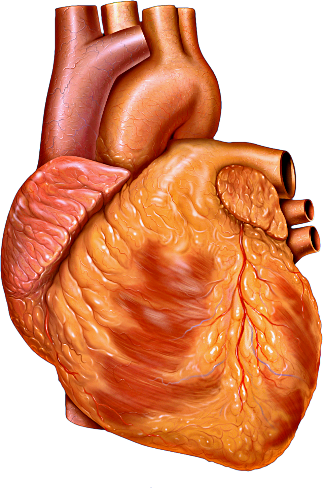
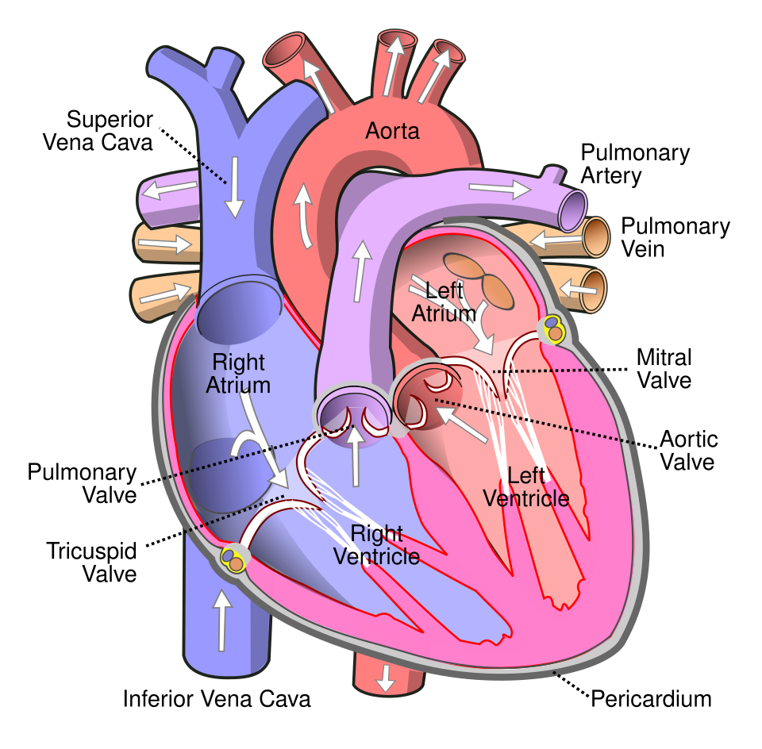

# Rapport de projet — Prédiction de la maladie cardiaque

**Module :** Introduction à Python, analyse de données et Machine Learning  
**Projet :** Projet de synthèse — analyse de données et Machine Learning  
**Secteur :** Santé (cardiologie)  
**Étudiants (groupe) :** Faker BEN NOOMEN, Haythem BEN BOUBAKER, Mariem DRIDI  
**Tâche :** Classification binaire supervisée (maladie cardiaque : **Oui / Non**)  
**Outils :** Python, Jupyter Notebook, pandas, matplotlib, seaborn, scikit-learn, Streamlit  
**Jeu de données :** `heart_disease_uci.csv` (UCI Heart Disease, version combinée multi-centres)

---

## 1. Contexte, idée, problématique et cible (Oui / Non)

### 1.1 Contexte métier et idée du projet
Les maladies cardiovasculaires (dont les maladies coronariennes) figurent parmi les principales causes de mortalité. Dans un parcours de soins, les cliniciens disposent de mesures de routine (âge, symptômes, tension, cholestérol, ECG, épreuve d’effort, etc.). L’idée du projet est de construire un **outil d’aide à la décision** (pédagogique) qui estime, à partir de ces données, le **risque de présence d’une maladie cardiaque** afin d’aider au dépistage et à la priorisation des examens.

<table>
<tr>
<td width="45%"></td>
<td width="55%"></td>
</tr>
<tr>
<td><em>Figure 1 — Cœur humain réel (vue antérieure). Source : Wikimedia Commons.</em></td>
<td><em>Figure 2 — Schéma explicatif de l’anatomie du cœur. Source : Wikimedia Commons.</em></td>
</tr>
</table>

### 1.2 Problématique (question métier)
**Peut-on prédire la présence d’une maladie cardiaque à partir de variables cliniques de routine, afin d’aider au dépistage et à la priorisation des examens complémentaires ?**

### 1.3 Comment répond-on « maladie cardiaque : Oui ou Non » ? (cible / target)
- **Variable originale du dataset :** `num` (diagnostic angiographique)
  - `0` = **absence** de maladie cardiaque
  - `1, 2, 3, 4` = **présence** de maladie cardiaque (sévérité croissante)
- **Variable cible créée pour le modèle (classification binaire) :** `target`
  - `target = 1` (**Oui**, malade) si `num > 0`
  - `target = 0` (**Non**, non malade) si `num == 0`

**Justification :** pour le dépistage/pré-triage, la question métier est d’abord de savoir s’il y a **présence ou absence** de maladie. La binarisation rend le résultat interprétable (« Oui/Non ») et mieux adapté aux effectifs des classes de sévérité 1–4.

> **Avertissement :** ce projet est pédagogique. Il ne constitue ni un diagnostic médical ni un avis clinique ; une **vérification humaine** par un professionnel de santé est indispensable.

---

## 2. Données : source, description, variables (jargon expliqué) et biais

### 2.1 Source et origine
- **Source :** UCI Machine Learning Repository — *Heart Disease* (centres : Cleveland, Hungary, Switzerland, VA Long Beach).
- **Lien UCI :** https://archive.ics.uci.edu/dataset/45/heart+disease  
- **Fichier utilisé :** `heart_disease_uci.csv` (version combinée, Kaggle : https://www.kaggle.com/datasets/redwankarimsony/heart-disease-data)
- **Licence/conditions :** données publiques de référence, **anonymisées**, utilisées à des fins pédagogiques.
- **Format / volume :** CSV, **920 observations** (patients), **16 variables**.

### 2.2 Variables et jargon clinique expliqué (en langage simple)

| Variable | Nom / jargon | Explication simple | Type (brut) | Rôle |
|---|---|---|---|---|
| `id` | Identifiant | Numéro unique du patient | entier | Exclu |
| `age` | Âge | Âge du patient (années) | entier | Feature |
| `sex` | Sexe | Sexe biologique (Male/Female) | catégoriel | Feature |
| `dataset` | Centre | Hôpital/centre d’origine des données | catégoriel | Métadonnée (exclue des features) |
| `cp` | Chest pain (douleur thoracique) | Type de douleur : angine typique/atypique, non-angineuse, asymptomatique | catégoriel | Feature |
| `trestbps` | Resting blood pressure | Pression artérielle au repos (mm Hg), à l’admission | numérique | Feature |
| `chol` | Cholestérol sérique | Taux de cholestérol dans le sang (mg/dl) | numérique | Feature |
| `fbs` | Fasting blood sugar | Glycémie à jeun > 120 mg/dl (Oui/Non) | booléen | Feature |
| `restecg` | ECG au repos | Résultat de l’électrocardiogramme au repos (normal, anomalie ST-T, hypertrophie VG) | catégoriel | Feature |
| `thalch` | Max heart rate | Fréquence cardiaque maximale atteinte à l’effort (bpm) | numérique | Feature |
| `exang` | Exercise-induced angina | Angine/douleur provoquée par l’effort (Oui/Non) | booléen | Feature |
| `oldpeak` | Dépression ST | Baisse du segment ST à l’effort vs repos (signe d’ischémie possible) | numérique | Feature |
| `slope` | Pente du segment ST | Allure de la pente ST à l’effort (montante, plate, descendante) | catégoriel | Feature |
| `ca` | Vaisseaux colorés | Nombre de vaisseaux majeurs (0–3) visibles à la fluoroscopie | numérique | Feature |
| `thal` | Thalassémie (test) | Résultat du test de perfusion : normal, défaut fixe, défaut réversible | catégoriel | Feature |
| `num` | Diagnostic | 0 = absence ; 1–4 = présence/sévérité de maladie | entier | **Cible originale** |
| `target` | Maladie cardiaque (Oui/Non) | 1 si `num>0` (Oui), 0 si `num==0` (Non) | entier | **Cible modélisée** |

### 2.3 Biais et limites des données
- Hétérogénéité multi-centres (protocoles, complétude des mesures).
- Valeurs manquantes importantes (`ca`, `thal`, `slope`) et valeurs invalides observées (`chol==0`, `trestbps==0`).
- Sur-représentation masculine ; dataset ancien et taille modeste (920) → généralisation limitée.

---

## 3. Compréhension, nettoyage et préparation (avant/après)

### 3.1 Compréhension initiale (pandas)
Exploration réalisée avec : `head()`, `tail()`, `shape`, `columns`, `info()`, `describe()` et `describe(include='all')`.
- **Constats :** 920×16, types mixtes, manquants notables (`ca` ~66%, `thal` ~53%, `slope` ~34%), aucun doublon, valeurs 0 non plausibles pour `chol` et `trestbps`, cible originale `num` (0–4).

### 3.2 Nettoyage et préparation (justifications)
| Action | Justification | Effet (avant/après) |
|---|---|---|
| Recherche de doublons | Éviter la duplication d’observations | Aucun doublon (0 avant/après) |
| `chol == 0` → `NaN` | Valeur physiologiquement invalide | 172 zéros corrigés en manquants (puis imputés) |
| `trestbps == 0` → `NaN` | Valeur physiologiquement invalide | 1 zéro corrigé en manquant (puis imputé) |
| Création de `target` | Répondre à la question Oui/Non (présence/absence) | `target` ajoutée : 411 Non (0), 509 Oui (1) |
| Imputation (médiane/mode) via pipeline | Conserver l’information malgré les manquants | Imputation faite **à l’entraînement** (fit sur train) |
| Encodage One-Hot + standardisation | Rendre catégories/échelles exploitables | Transformations dans le pipeline |
| Exclusion `id`, `num`, `dataset` | Éviter identifiant, fuite de cible, métadonnée non clinique | 13 features cliniques retenues |

**Comparaison avant/après :** 920 lignes conservées ; incohérences 0 traitées ; cible binaire claire (Oui/Non) ; prétraitement sans fuite de données.

### 3.3 Préparation pour la modélisation (anti-fuite)
- **Split :** 80% train / 20% test, **stratifié**, `random_state=42`.
- **Pipeline scikit-learn :** imputation + encodage + standardisation **ajustés sur le train uniquement**, appliqués au test.
- **Aucune fuite :** pas de statistique calculée sur le test, pas de variable donnant directement la réponse (`num`) en entrée.

---

## 4. Analyse exploratoire et visualisations (≥ 5 graphiques)

Au moins cinq graphiques de types différents, avec titre, axes lisibles et interprétation courte (notebook et dashboard) :

1. **Barres** — Répartition de `target` (Oui/Non) : classes relativement équilibrées (411 / 509).
2. **Histogramme + densité** — Âge selon la cible : prévalence plus élevée avec l’âge, distributions qui se chevauchent.
3. **Boxplots** — `thalch` et `oldpeak` selon la cible : `thalch` plus faible et `oldpeak` plus élevé chez les patients malades.
4. **Barres groupées (countplot)** — Type de douleur (`cp`) selon la cible : profil *asymptomatic* fortement associé aux cas positifs.
5. **Barres horizontales** — Valeurs manquantes par variable : `ca`, `thal`, `slope` très incomplets.
6. *(Complémentaire)* **Camembert** — Répartition par sexe : majorité masculine (biais potentiel).

**Lecture métier :** symptômes et variables d’effort (`cp`, `exang`, `thalch`, `oldpeak`, etc.) sont informatifs ; la qualité/hétérogénéité des données limite la portée des conclusions.

---

## 5. Relations entre variables, corrélations et précautions méthodologiques

### 5.1 Analyse réalisée (exploratoire)
- **Méthode :** matrice de corrélation de Pearson (variables catégorielles encodées numériquement à des fins exploratoires) et corrélations des variables avec `target`.
- **Résultats observés (cohérents avec le dataset UCI, associations plausibles médicalement) :** les variables les plus associées (en valeur absolue) incluent `exang`, `ca`, `thalch`, `oldpeak`, `cp`, `slope`, `sex`, `age`, `thal` ; `fbs`, `chol`, `trestbps`, `restecg` présentent des associations plus faibles.

| Variable | Corrélation avec `target` (exploratoire) | Lecture indicative |
|---|---:|---|
| `exang` | +0.464 | Angine à l’effort associée à la présence de maladie |
| `ca` | +0.456 | Plus de vaisseaux majeurs colorés associé au risque |
| `thalch` | -0.395 | Fréquence max plus faible associée à la maladie |
| `oldpeak` | +0.386 | Dépression ST plus élevée associée à la maladie |
| `cp` | -0.385 | Association dépendante de l’encodage des catégories |
| `slope` | -0.337 | Association dépendante de l’encodage/ordre |
| `sex` | +0.307 | Association observée (échantillon majoritairement masculin) |
| `age` | +0.283 | Risque tendant à augmenter avec l’âge |
| `thal` | +0.253 | Association faible à modérée (selon encodage) |
| `fbs` | +0.143 | Relation faible |
| `chol` | +0.118 | Relation faible |
| `trestbps` | +0.117 | Relation faible |
| `restecg` | +0.059 | Relation très faible |

### 5.2 Précautions méthodologiques importantes
- **Corrélation ≠ causalité.**
- Les variables n’ont pas toutes la même nature : `age`, `chol`, `thalch`, `oldpeak`, `trestbps`, `ca` sont numériques ; `sex`, `exang`, `fbs` sont binaires/catégorielles ; `cp`, `restecg`, `thal`, `slope` sont catégorielles (nominales/ordinales). Un encodage arbitraire des catégories peut influencer le **signe** et l’interprétation (ex. `cp`).
- **Amélioration recommandée (rigueur statistique) :** analyser séparément (1) les variables numériques (Pearson/Spearman) avec la cible binaire, et (2) les variables catégorielles via test du Chi-deux et **V de Cramér** (ou méthodes adaptées aux variables ordinales).
- **Ne pas exclure automatiquement** les variables à faible corrélation individuelle (`chol`, `trestbps`, `restecg`, etc.) : elles peuvent apporter de l’information en combinaison dans des modèles non linéaires (ex. Random Forest).

### 5.3 Conclusion d’analyse de corrélation (synthèse)
L’étude des relations entre les variables explicatives et la cible `target` (maladie cardiaque : Oui/Non) met en évidence que `exang`, `ca`, `thalch` et `oldpeak` figurent parmi les variables les plus associées (en valeur absolue) dans ce dataset. À l’inverse, `fbs`, `chol`, `trestbps` et `restecg` montrent des associations plus faibles. Ces résultats orientent l’analyse exploratoire et la sélection/hiérarchisation des variables, tout en rappelant qu’une corrélation n’implique pas de causalité et que les variables catégorielles nécessitent des méthodes d’association adaptées. Cette étape prépare la modélisation par apprentissage automatique.

---

## 6. Modélisation (classification), comparaison et évaluation

### 6.1 Protocole
- **Tâche :** classification binaire (`target` : 1 = Oui, 0 = Non).
- **Split :** train 80% / test 20%, stratifié, `random_state=42`.
- **Baseline (référence) :** `DummyClassifier` (classe majoritaire).
- **Modèles comparés :** Régression Logistique, Random Forest, KNN (k=7).
- **Prétraitement :** pipeline (imputation médiane/mode, One-Hot, standardisation) ajusté sur le train uniquement.

### 6.2 Métriques
- **Classification (exigées) :** Accuracy, Précision, Rappel, F1-score, Matrice de confusion.
- **Compléments :** ROC-AUC, MAE, MSE, RMSE, R² (calculés sur probabilités/prédictions vs cible 0/1, utiles en complément ; en classification, priorité aux métriques de confusion/rappel/F1).

> *Remarque :* pour une régression, le cahier des charges demande MAE, RMSE et R² ; la tâche retenue ici est une **classification**, donc ces métriques sont fournies en complément.

### 6.3 Résultats et comparaison
Les tableaux comparatifs, matrices de confusion, rapports de classification et courbes ROC sont produits dans le notebook exécuté et le dashboard Streamlit. Les modèles appris sont comparés à la baseline et entre eux :
- **Critère recommandé :** bon compromis **F1** et **Rappel** (limiter les faux négatifs en dépistage) avec Accuracy/ROC-AUC satisfaisantes, en surpassant la baseline.
- **Faux négatifs** (malades prédits « Non ») : erreur la plus critique ; **faux positifs** : fausses alertes.

*(Voir sorties de `heart_disease_project_organized.ipynb` — exécuté — et `resultats_modeles.csv`.)*

---

## 7. Interprétation, cas de test (réel vs prédit), limites

### 7.1 Cas de test (réel vs prédit)
Des exemples du **jeu de test** (données non vues) comparent `valeur_reelle` et `valeur_predite` (Oui/Non, 1/0), la probabilité estimée et l’analyse (Correct, Faux négatif, Faux positif). Fichiers/export : `exemples_reel_vs_predit.csv`.

### 7.2 Interprétation des erreurs et risques
- **Faux négatif (FN)** : patient malade prédit sain → risque de retard de prise en charge.
- **Faux positif (FP)** : patient sain prédit malade → stress/examens inutiles.
- **Risques de mauvaise interprétation :** sur-confiance dans une probabilité, biais des données, confusion corrélation/causalité, généralisation abusive. Une probabilité n’est pas un diagnostic.

### 7.3 Limites
- Données multi-centres hétérogènes, manquants importants, 920 observations, dataset ancien.
- Biais de représentativité (sexe majoritaire), absence de validation externe/clinique.
- Cible binarisée (perte d’information de sévérité), optimisation limitée.

---

## 8. Conclusion et recommandations

### 8.1 Conclusion
Le projet répond à la problématique par une démarche complète : compréhension et préparation des données (comparaison avant/après, pipeline sans fuite), EDA (≥ 5 graphiques), étude des corrélations (avec précautions méthodologiques), modélisation supervisée (baseline + plusieurs modèles) évaluée sur jeu de test (Accuracy, Précision, Rappel, F1, matrices de confusion, compléments ROC-AUC/RMSE/MAE/R²), et analyse réel vs prédit. Le modèle le plus adapté est celui offrant le meilleur compromis F1/rappel selon les résultats de l’exécution, en surpassant la baseline.

### 8.2 Recommandations concrètes pour le secteur santé
1. **Aide à la décision avec validation humaine obligatoire :** utiliser le modèle uniquement pour le pré-triage/dépistage, en privilégiant la limitation des faux négatifs ; toute prédiction doit être confirmée par un professionnel de santé (pas de décision automatisée).
2. **Améliorer la qualité et la représentativité des données :** compléter les variables manquantes, collecter des données plus récentes et multi-populations, documenter les biais et réévaluer régulièrement les performances.
3. **Renforcement méthodologique (perspective) :** validation croisée, optimisation d’hyperparamètres, calibration des probabilités, analyses d’association adaptées aux variables catégorielles (Chi-deux, V de Cramér), explicabilité (SHAP) et validation externe.

---

## 9. Éthique et responsabilité

- **Conséquences d’une erreur :** un **faux négatif** peut retarder la prise en charge d’un patient (risque santé) ; un **faux positif** peut entraîner anxiété, examens inutiles et coûts. Patients, soignants et établissement sont concernés.
- **Risques pour les libertés, la vie privée ou l’image :** données UCI publiques et anonymisées, mais un usage mal encadré peut induire biais/discriminations, décisions inéquitables et atteinte à l’image de l’organisation.
- **Vérification humaine :** toute sortie doit être revue par un professionnel qualifié ; le système est une **aide à la décision** avec traçabilité et validation humaine avant toute action.
- **Données :** respect des licences et de la finalité pédagogique, vigilance sur la qualité et les biais.

---

## 10. Livrables et exécution

- **Notebook :** `heart_disease_project_organized.ipynb` (exécutable de haut en bas, *Restart & Run All*, `random_state=42`, sorties régénérées).
- **Dashboard :** `app.py` (Streamlit) — indicateurs, graphiques, corrélations, comparaison modèles, scénario de prédiction (Oui/Non), probabilité, niveau de risque et alertes (aide à la décision).
- **Rapport :** `rapport_projet.md` / `rapport_projet.pdf`.
- **Données :** `heart_disease_uci.csv` (brut), `heart_disease_cleaned.csv` (nettoyé/préparé de base), `resultats_modeles.csv`, `exemples_reel_vs_predit.csv`.
- **Lancement Streamlit :** `cd /home/himawari/workSpace/1 && .venv/bin/python -m streamlit run app.py` (http://localhost:8501)

---

## Références et attributions
- Janosi, A., Steinbrunn, W., Pfisterer, M., & Detrano, R. (1989). *Heart Disease* [Dataset]. UCI Machine Learning Repository. https://archive.ics.uci.edu/dataset/45/heart+disease
- Detrano, R. et al. (1989). International application of a new probability algorithm for the diagnosis of coronary artery disease. *American Journal of Cardiology*.
- Kaggle Dataset : redwankarimsony/heart-disease-data. https://www.kaggle.com/datasets/redwankarimsony/heart-disease-data
- Notebooks Kaggle consultés (veille) : Fahad Rehman — “Heart Disease Prediction Using 9 Models” ; Muhammad Hanzla — “Heart Disease Prediction with 77.55% Accuracy”.
- Images : Wikimedia Commons — « Heart anterior exterior view » et « Diagram of the human heart (cropped) » (voir pages sources/licences sur Wikimedia Commons).
- Documentation : pandas, matplotlib, seaborn, scikit-learn, Streamlit.
